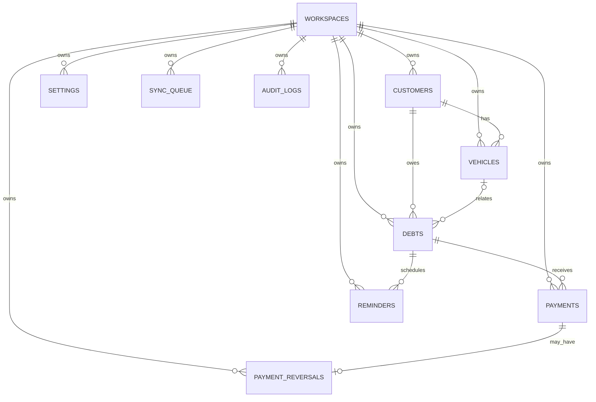

# Banco de dados local

## Estado da implementação

O Prompt 04 implementou a infraestrutura local com Expo SQLite 58, Drizzle ORM 0.45 e migrations versionadas. Os Prompts 05 a 07 conectaram os módulos de clientes, veículos e fiados ao banco. O banco persistente chama-se `fiados-moreira.db`, vive no armazenamento privado do aplicativo e é a fonte operacional offline.

Não existe Supabase, autenticação, worker de sincronização, backup definitivo nem criptografia própria do arquivo nesta etapa.

## Arquitetura

```text
DatabaseProvider
  ├── client.ts → abre SQLite, aplica PRAGMAs e migrations
  ├── Drizzle → schema, relações, tipos e migration mobile
  └── SqlExecutor parametrizado
       ├── repositories → persistência por workspace
       └── services → validação + transação + auditoria
```

`DatabaseProvider` possui os estados `initializing`, `ready` e `error`. Ele é montado no layout raiz depois do tema/fontes e antes da navegação. Em falha, preserva o arquivo e oferece nova tentativa, sem expor SQL ou caminhos ao usuário.

## Configuração SQLite

Na abertura da conexão são executados:

- `foreign_keys = ON`, para ativar as FKs físicas;
- `journal_mode = WAL`, para durabilidade e melhor concorrência;
- `synchronous = FULL`, por se tratar de registros financeiros;
- `busy_timeout = 5000`, para aguardar bloqueios transitórios.

O executor serializa todas as operações na conexão. Serviços financeiros usam `BEGIN IMMEDIATE`, leem o saldo e gravam operação/auditoria na mesma transação. A opção foi preferida à conexão separada de `withExclusiveTransactionAsync`, cujos PRAGMAs não são herdados automaticamente no Expo SQLite.

## Drizzle e migrations

- Configuração: `drizzle.config.ts`.
- Schema: `src/database/schema`.
- Saída versionável: `drizzle/` (SQL, journal, snapshot e módulo para Expo).
- Bundle: Babel importa `.sql` inline e Metro reconhece a extensão.
- Inicialização: `drizzle-orm/expo-sqlite/migrator` registra migrations em `__drizzle_migrations` e não reaplica versões concluídas.

Comandos:

```bash
npm run db:generate  # gera uma migration a partir do schema
npm run db:check     # verifica a consistência do histórico
npm run db:test      # executa testes de banco, repositórios e domínio
```

Para uma mudança futura, altere o schema, execute `npm run db:generate`, revise SQL e metadados, rode `npm run db:check` e a suíte completa. Não use `drizzle-kit push` em produção e não apague o banco diante de falha.

## Diagrama



## Dicionário de dados

Todos os nomes físicos usam `snake_case`; propriedades TypeScript usam `camelCase`. UUIDs são `TEXT`, valores financeiros são `INTEGER`, instantes são ISO 8601 UTC em `TEXT` e datas civis são `YYYY-MM-DD`.

| Tabela              | Campos principais                                                                   | Integridade e índices relevantes                                                                                               |
| ------------------- | ----------------------------------------------------------------------------------- | ------------------------------------------------------------------------------------------------------------------------------ |
| `workspaces`        | `id`, `name`, `timezone`, `currency`, timestamps                                    | PK UUID; workspace inicial idempotente (`Oficina Moreira`, `BRL`, `America/Fortaleza`)                                         |
| `customers`         | workspace, nome, telefones, endereço, notas, timestamps de arquivo/exclusão lógica  | FK restritiva; únicos auxiliares `(workspace_id,id)`; índices por nome, telefone e arquivamento                                |
| `vehicles`          | workspace, cliente, tipo, marca, modelo, ano, placa, cor, notas                     | FK composta workspace/cliente; tipo e ano com `CHECK`; índices por cliente e placa                                             |
| `debts`             | workspace, cliente, veículo opcional, descrição, `total_cents`, datas, cancelamento | FKs compostas validam workspace e dono do veículo; total positivo/limitado; índices por cliente, datas, cancelamento e veículo |
| `payments`          | workspace, fiado, `operation_id`, `amount_cents`, método, `paid_at`, notas          | FK composta; operação única por workspace; valor/método com `CHECK`; índices por fiado e período                               |
| `payment_reversals` | workspace, pagamento, `operation_id`, motivo, `reversed_at`                         | um estorno por pagamento; operação única; FK restritiva                                                                        |
| `reminders`         | workspace, fiado, tipo, agendamento, estado, ID da notificação                      | enums por `CHECK`; índice workspace/estado/agendamento; não agenda notificações nesta etapa                                    |
| `settings`          | workspace, chave, JSON, atualização                                                 | PK composta `(workspace_id,key)`; não armazena segredos                                                                        |
| `sync_queue`        | workspace, entidade, operação, estado, tentativas e erro sanitizado                 | estrutura futura; `CHECK` de enum/tentativas e índice de processamento                                                         |
| `audit_logs`        | workspace, entidade, ação, operação, metadados minimizados e instante               | operação única quando informada; append-only pelos fluxos normais; índices por entidade e data                                 |

Não há `ON DELETE CASCADE` em relacionamentos financeiros. As FKs compostas impedem associação entre oficinas e, em fiados, associação a veículo de outro cliente.

## Identificadores e tempo

IDs e identificadores de operação são UUID v4 criptograficamente seguros gerados por `expo-crypto`. Eles funcionam offline e são compatíveis com o futuro PostgreSQL. O workspace é criado uma única vez na inicialização.

Instantes usam `new Date().toISOString()` (UTC). `service_date` e `due_date` são datas civis sem horário. A condição de atraso calcula a data civil atual com o fuso do workspace e aceita uma data de referência injetável para testes.

## Dinheiro, saldo e status

O limite operacional é `99.999.999.999` centavos (R$ 999.999.999,99), definido por `MAX_CURRENCY_CENTS`. Entradas exigem inteiro seguro, positivo quando aplicável, sem `NaN`, infinito ou ponto flutuante. Somas também são validadas.

```text
líquido pago = bruto pago - pagamentos integralmente estornados
saldo = valor original - líquido pago
```

Saldo negativo é erro; não é mascarado com `Math.max`. Os estados financeiros derivados são `pending`, `partially_paid`, `paid` e `canceled`. `isOverdue` é uma condição independente e dinâmica.

## Repositórios e serviços

Repositórios disponíveis: `WorkspaceRepository`, `CustomerRepository`, `VehicleRepository`, `DebtRepository`, `PaymentRepository`, `PaymentReversalRepository`, `AuditRepository`, `DashboardRepository` e `GlobalSearchRepository`. Todos recebem um `SqlExecutor`, usam parâmetros e exigem `workspaceId` nas consultas de domínio.

Serviços financeiros:

- `DebtService`: cria, atualiza e cancela fiados com auditoria; impede criação para cliente arquivado, total menor que líquido pago e cancelamento com pagamento líquido;
- `PaymentService`: registra pagamento sob bloqueio transacional, rejeita cancelado/quitado/excesso e grava auditoria;
- `PaymentReversalService`: cria estorno integral único, preserva o pagamento e grava auditoria.

O módulo visual de pagamentos consome esses serviços sem escrever diretamente nos repositórios. `PaymentRepository.findDetails` consulta pagamento, fiado, cliente e eventual estorno em uma projeção isolada por workspace. `DashboardRepository` consolida saldos, recebimentos por período civil, vencimentos e atividades recentes sem N+1. `GlobalSearchRepository` agrupa clientes, veículos, fiados e pagamentos, limita cada categoria e delega saldos e status aos repositórios financeiros existentes. Nenhuma migration foi necessária nos Prompts 08, 10 e 11.

Zod valida entradas separadas dos registros de persistência. Telas não executam SQL. O módulo de clientes consome `CustomerService` para mutações transacionais e `CustomerRepository` para leituras, busca, contagens, duplicidades e resumo financeiro. O módulo de veículos usa `VehicleService` para mutações auditadas e `VehicleRepository` para detalhes, lista por cliente, pesquisa e duplicidade de placa.

Os Prompts 05 a 07 não alteraram o schema nem migrations. O módulo de fiados usa consultas agregadas isoladas por workspace para retornar cliente, veículo, bruto pago, estornos, líquido, saldo e situação derivados pelo domínio. As buscas sem acento normalizam em memória somente os registros já isolados por workspace. Uma coluna indexada de busca será considerada apenas se medições reais justificarem nova migration.

## Idempotência, concorrência e auditoria

Pagamentos e estornos têm `operation_id` único por workspace. Repetir a mesma operação e os mesmos dados retorna o registro existente; reutilizar o ID com dados diferentes retorna `IDEMPOTENCY_CONFLICT`. A interface mantém identificador, data e instante da tentativa estáveis durante reenvios.

A fila da conexão mais `BEGIN IMMEDIATE` impede que dois pagamentos concorrentes observem o mesmo saldo livre. Falha em qualquer passo, inclusive auditoria, faz rollback. A auditoria local preserva rastreabilidade, mas não é inviolável; hardening adicional pertence ao Prompt 20.

## Arquivamento e retenção

Clientes e veículos usam `archived_at` para sair dos fluxos ativos sem perder relações. `deleted_at` está reservado para exclusão lógica com política futura de privacidade. Fiados usam cancelamento, pagamentos usam estorno e registros financeiros não possuem API de exclusão física.

Retenção, anonimização e exclusão de dados pessoais serão tratadas na etapa de segurança e privacidade.

## Sincronização futura

`sync_queue` existe apenas como estrutura: nenhum registro é gerado enquanto não houver consumidor no Prompt 19. SQLite e Supabase não sincronizam automaticamente. A implementação futura deverá importar os registros locais preexistentes, deduplicar pagamentos, resolver conflitos explicitamente, revalidar finanças no servidor e aplicar autenticação/RLS.

## Segurança e limitações

- arquivos `*.db`, WAL/SHM, backups e dumps locais são ignorados pelo Git;
- consultas recebem parâmetros; `execAsync` é usado somente para SQL estático controlado;
- mensagens de produção não contêm SQL, stack, caminhos ou dados pessoais;
- o arquivo fica no sandbox privado do aplicativo, o que **não equivale a criptografia do banco**;
- SQLCipher não foi ativado: exige avaliação de suporte nativo, build de desenvolvimento, chaves no SecureStore e recuperação segura no Prompt 20;
- não há credenciais no SQLite comum;
- o aplicativo ainda não deve ser considerado pronto para dados reais até validar dispositivo, criptografia/ameaças, backup e recuperação.

## Testes

Os testes de domínio cobrem dinheiro, saldo, estorno, status e fuso. Testes de integração usam SQLite real e isolado via `node:sqlite`, aplicam o SQL versionado, verificam constraints/índices/integridade, reabertura, repositórios, atomicidade, idempotência e concorrência.

O adaptador Node usa a mesma engine SQLite e os mesmos arquivos SQL, mas não substitui a validação do Expo SQLite em Android/iOS. A abertura mobile, PRAGMAs e empacotamento também são verificados por TypeScript e bundles; teste em dispositivo/emulador continua necessário.
